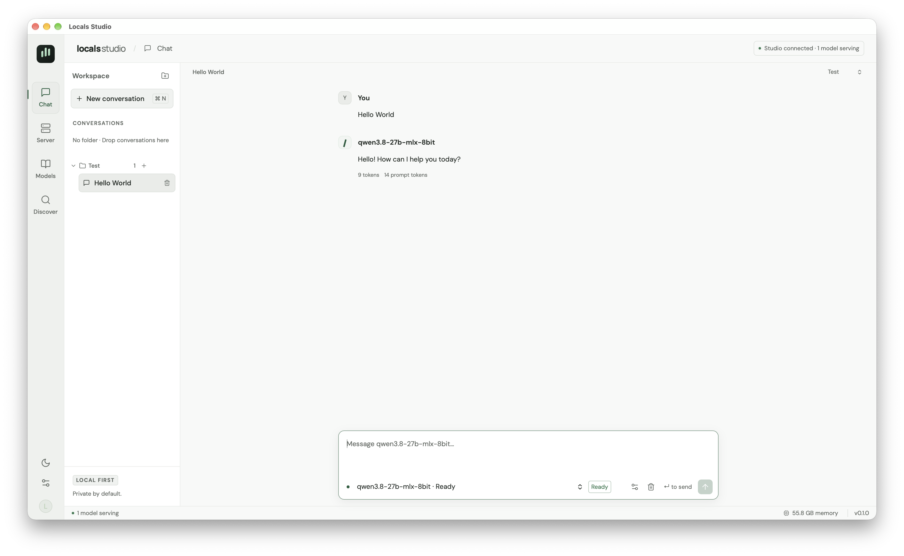
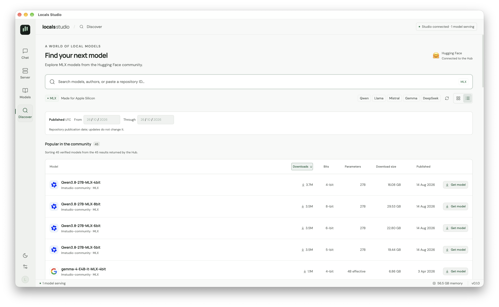
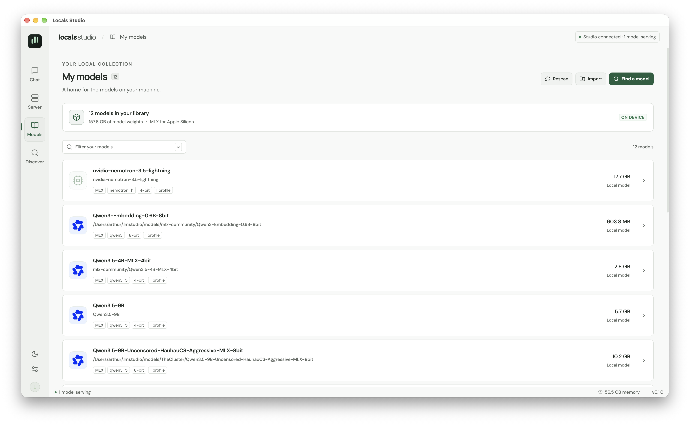
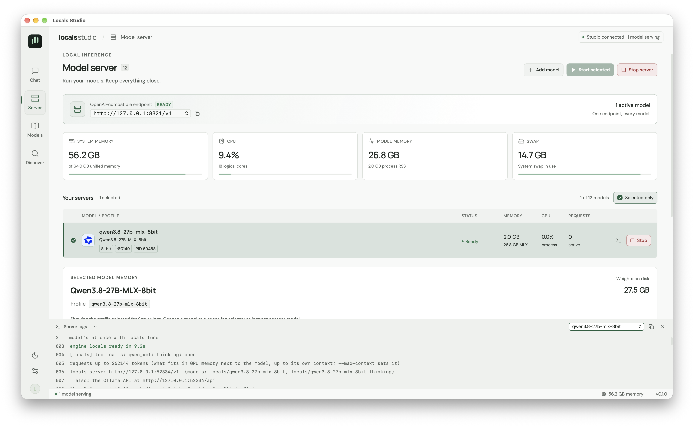

#  Locals Studio

An Apple Silicon macOS app and CLI for configuring, downloading, and serving MLX models with [Locals](https://github.com/Generated-Computers/Locals).

Locals Studio is an independent frontend developed by Armateur Labs for Locals, the inference backend by [Generated Computers](https://generatedcomputers.com/). It is not affiliated with, endorsed by, or maintained by Generated Computers or the Locals project.

Tauri 2 + React/Vite power the interface; Rust powers the persistent service, CLI, and HTTP router. Each active profile runs its own Locals Python process. Closing the window keeps models and downloads running.

## Screenshots

Click a screenshot to view it at full size.

| Chat | Discover |
| --- | --- |
| [](docs/screenshots/chat.png) | [](docs/screenshots/discover.png) |

| My models | Model server |
| --- | --- |
| [](docs/screenshots/my-models.png) | [](docs/screenshots/model-server.png) |

## Getting started

Development requirements: macOS 14+, Apple Silicon, Xcode build tools, Rust, Node/npm, and [uv](https://docs.astral.sh/uv/). Installing the runtime downloads Python 3.12 and the locked MLX dependencies.

```sh
npm ci
npm run desktop
```

The script builds the service and prepares it as a Tauri sidecar. You can work on the interface with the frontend alone (`npm run dev`); it shows the connection as unavailable in a regular browser because the management bridge runs through Tauri.

To build the app, DMG, and Installer package:

```sh
npm run desktop:build
```

Build artifacts are generated in `target/release/bundle/`: `macos/`, `dmg/`, and `pkg/`. The build also extracts and verifies the Installer package. Distribution signing and notarization use the standard Tauri settings; local builds can use ad hoc app signing.

Use **`Locals Studio_0.1.1_aarch64.pkg`** to install the app and terminal command together. The macOS Installer places the app in `/Applications/Locals Studio.app`, creates `/usr/local/bin/locals-studio` pointing to the bundled CLI, and registers `/usr/local/bin` through `/etc/paths.d/locals-studio`. Open a new terminal window afterward. Existing terminal environments and custom shell configurations are not rewritten. The package checks for conflicting apps, commands, and PATH entries before changing files; it preserves an unrelated existing command instead of overwriting it. Upgrades keep the app at its fixed installation path.

The DMG remains available for drag-and-drop installation. With that method, add the bundled CLI manually:

```sh
mkdir -p "$HOME/.local/bin"
ln -s "/Applications/Locals Studio.app/Contents/MacOS/locals-studio" "$HOME/.local/bin/locals-studio"
```

The `~/.local/bin` directory must be in your terminal's PATH. Rebuild only the PKG from an already built app with `npm run installer:build`; check its extracted contents with `npm run installer:verify`. Local PKGs are unsigned unless `LOCALS_STUDIO_INSTALLER_SIGNING_IDENTITY` names a Developer ID Installer identity. App signing and Apple notarization remain separate distribution steps.

## Tag builds on GitHub Actions

The **Build macOS installers** workflow runs when a Git tag is pushed, or manually through **Actions → Build macOS installers → Run workflow** with the desired branch or tag selected. It builds the app, bundled service, DMG, and PKG on the `macos-15` Apple Silicon runner with `npm ci` and `npm run desktop:build -- --ci -- --locked`, then verifies the app signature, DMG integrity, and extracted PKG payload.

Download the installers from **Actions → Build macOS installers → the run → Artifacts**. The DMG and PKG are published separately as `locals-studio-dmg-macos-arm64-<commit SHA>` and `locals-studio-pkg-macos-arm64-<commit SHA>`, retained for 30 days. Each upload fails if its installer is missing. Builds use the project's existing ad hoc app signing configuration and an unsigned PKG unless an Installer signing identity is configured.

For a tag run, the workflow also attaches the DMG and PKG directly under **Releases → the tag → Assets**, creating the release if needed. An existing release keeps its notes, draft/prerelease status, and other assets. Existing installer assets with the same names are not overwritten; publication stops on a name collision. A manual run on a branch produces Actions artifacts only and does not create a tag or release.

GitHub Actions embeds the build identity shown in the app’s status bar and About panel: the selected tag for a tag build, otherwise a tag pointing exactly at the checked-out commit, otherwise the first seven characters of that commit. The workflow fetches tags before resolving this value. About keeps the package version separately, and the build tooltip includes the full commit SHA. Local builds resolve the same Git metadata.

The installer version comes from the project manifests; update those versions before tagging a release. A display tag does not change the installer version. See [CHANGELOG.md](CHANGELOG.md) for release notes.

## Features

- **Chat**: served models, streaming and cancellation, folders, conversations, and generation settings.
- **Model server**: local server search, saved model selection, global or individual start/stop controls, live model activity and tokens/s, memory and CPU usage, MLX allocations, and per-worker logs.
- **My models**: HF/LM Studio discovery, importing folders without copying them, server profiles, and advanced configuration.
- **Discover**: MLX-filtered HF search, published model details and variants, and persistent downloads with pause/resume support.

Conversations inside a folder are indented beneath its header; conversations without a folder stay at the top level.

The Studio status indicator distinguishes service connectivity from inference readiness. Green means the inference API and at least one model are ready; an idle service, stopped inference, or reconnecting updates use an amber indicator. An unavailable service or API error is reported separately. **Start selected** is unavailable when every selected model is already running or changing state; selecting a stopped model enables it. **Start server** can still open a stopped API without loading a model.

Discover shows the Hugging Face repository publication date in cards, list rows, and model details. **Published from** and **Published through** filter an inclusive UTC date range, and **Published** sorts by that date. Date preferences persist; repository updates do not change the publication date. Models with an unknown date stay last when sorting and are excluded by an active date filter.

Discover only lists repositories whose complete MLX bundle and supported model configuration have been checked at an immutable revision. Candidates being checked and temporary verification failures are reported separately, with a retry action. Changing the revision in download details requires a new compatibility check before the download can start. Network, authentication, and gated-model failures remain distinct from incompatible or incomplete repositories.

In **My models**, use the star next to a model to add or remove a favorite. **Favorites only** filters the list and works with the search field. Favorites and the filter setting are saved on this Mac, including after restarting the app.

In **My models → Model details**, **Start model** starts the chosen server profile after the usual memory review, and **Use in new chat** opens an empty conversation with that profile selected. **Reload** restarts a running profile after a memory review; **Stop** stops that profile. Both controls are disabled when it is stopped. These actions sit above **Configure server**. Choose a profile when the model has several; an explicit start or chat action creates a default profile if none exists. Already running or starting profiles are not started again by **Start model**. Opening a chat does not start the model; the composer reports its availability.

In **Model server**, **Selected only**, **Favorites only**, and **Running only** combine with the search field. Favorites match the models starred in **My models**, including all their server profiles. **Running only** shows ready or running profiles. The filters are saved independently and only affect the visible list; **Start selected** keeps using the checked server profiles.

Each server row offers **Logs**, a configuration icon that opens the same **Model details** panel on that server profile, and a cross to remove the profile from **Your servers**. Removing a running profile asks to stop it first. Cancelling keeps it running and preserves the profile; an unsuccessful stop also prevents removal. The model stays in **My models**, and its files remain on disk.

Chat prefers a model that is already ready when starting a new conversation. The model selector sits below the message field. Manual selections and the model assigned to an existing conversation are preserved. The list shows model status; when sending is unavailable, the composer explains why and offers to open **Model server** to start the relevant server.

In the chat's **Inference** settings, **Thinking** controls the next reply: **Default** uses the running server's default, **On** requests reasoning, and **Off** explicitly disables it. The choice is saved with the conversation when you send a message and does not require restarting the model. Reasoning appears in the reply's **Thinking** section. The maximum output token budget includes both reasoning and the final answer, so a small budget may be exhausted before the answer starts. Thinking is available only when the model supports it.

The profile's **Default thinking** option sets Locals' startup default and takes effect after stopping and starting that server. For API clients, `/v1/models` also lists `<alias>-thinking` when the worker advertises that variant; both IDs use the same loaded model. The base alias uses the server default. Set `chat_template_kwargs.enable_thinking` to `true` or `false` on a chat-completion request to override that default, including when using a `-thinking` ID. Locals disables thinking for constrained JSON output and for `reasoning_effort: "none"`.

Drag a conversation onto a folder to move it; a collapsed folder opens after a successful drop. Use the **No folder** drop area to move it out of a folder, or use the conversation's folder selector with the keyboard. Moving preserves its messages, an active response, and the composer draft. Folder headers reserve space for the **+**, rename, and remove buttons; rename and remove appear on hover or keyboard focus without shifting **+**. Each chat row also has a delete button, highlighted on hover or keyboard focus. Both sidebar and composer deletion ask for confirmation with the chat title. Deleting another chat preserves the active chat and its draft; a running reply must be stopped first. Removing a folder also asks for confirmation, showing its name and saved-conversation count. Its conversations and messages are kept in **No folder**, together with any unsent draft; a reply already streaming continues. Older refreshes and queued saves cannot put a chat back into a removed folder.

**Discover** offers grid and list views, with the view, search, and sorting preferences saved locally. Cards, list rows, and download details show the published parameter size (**2B**, **4B**, **9B**, **37B**, etc.) and the complete download size. Exact weight-file bytes are no longer shown in Discover. Sort the Hub's returned result set, up to 50 models, by downloads, parameter size, quantization bits, or download size. In list view, click **Downloads**, **Bits**, **Parameters**, or **Download size** in the header to sort. A different column starts with the largest values first; clicking the active header or its arrow reverses the direction. Grid view offers the same direct sort buttons. Family filters, refresh, and grid/list controls share one toolbar row. Unknown values stay last; complete download totals precede partial ones. Older saved weight-size sorting preferences migrate to parameter sorting.

Parameter labels use the published nominal size in the model name or its documented base-model name. They are not exact tensor counts. Mixture-of-experts names such as **35B-A3B** show **35B**; published **E2B/E4B** classes are marked **effective**. Ambiguous or unavailable sizes remain **Unknown**. Studio does not infer parameters from file bytes or packed quantized Safetensors element counts.

Download sizes use decimal GB (**1 GB = 1,000,000,000 bytes**) and include the files selected by Studio: weights, tokenizer, and configuration. A size prefixed with **≥** is partial; unknown sizes remain unavailable. Visible results load metadata for their immutable HF commit; sorting by parameters or download size also enriches missing values outside the visible area, with at most three concurrent metadata requests. Changing the revision in the detail view may change the download size.

Up to eight recent searches are cached locally across app restarts, within a roughly 1 MiB limit. Results stay fresh for five minutes; older cached rows remain visible during a background refresh and if the network request fails. Recognized model-family or publisher avatars come from Hugging Face's official avatar endpoint, are shared across the publisher's models, and are cached on disk. A generic chip icon appears when an avatar is unavailable.

Profiles retain Locals defaults for any options left unset. Profile changes take effect the next time the worker starts. The worker fields `host`, `port`, and `model` are reserved for Studio.

In **Model server**, search by profile alias, model name, or repository. Search combines with **Selected only**, which filters the list to checked models while preserving alphabetical order. Both filters are saved on this Mac. Checked profiles have a stronger accent background and stripe; the profile inspected in the log panel remains independent. Filtering leaves the saved serving selection and global start/stop scope unchanged. If no models are selected, **Show all models** restores the full list.

Each server row shows its current activity and active request count. **Prompt** covers waiting for the first output, including queueing and prompt preparation; **Thinking** and **Generating** follow the response stream. Concurrent requests can show several phases. When Locals exposes generated tokens without a response phase, the row shows **Decoding**. Live **tok/s** measures changes in the worker's generated-token counters, including reasoning tokens; unavailable measurements remain **—**.

Use **Test API** beside the endpoint to fetch its `/v1/models` response. A dialog shows the request URL, HTTP status, elapsed time, and formatted JSON, with copy and retry controls. HTTP error responses remain visible; non-JSON responses are shown as text. Connection errors and timeouts appear in the same dialog.

In **Model server**, **Start server** opens the shared API and starts the saved selection; with no selection, it only opens the API. **Stop server** stops all models and closes the HTTP port. The management service remains available to the GUI, CLI, and downloads. The API's stopped state is preserved when Studio is reopened.

The **Selected model memory** card refers to the model selected in the list or log panel. This selection and the log selection are preserved when switching views. The card distinguishes active MLX allocations, reusable cache, current RSS, and peaks since the worker started. **0.8B** in a model name means approximately 800 million parameters; its memory usage depends on factors including quantization and caches. Weights on disk, RSS, and MLX allocations are separate measurements.

The **Server logs** panel starts closed and remembers whether you last opened or closed it, including across navigation and app restarts. Selecting a server preserves the panel’s open/closed state; the row’s logs button explicitly opens it. Choose **Oldest first** or **Newest first**; the order is saved on this Mac. Opening the panel joins the latest log lines and follows new output at the bottom or top respectively. Scrolling away pauses following while preserving the lines you are reading; **Follow** rejoins the latest output. Changing the inspected server, order, or search rejoins the latest matching lines. Search filters the current profile’s log lines without changing the selected server, and copying keeps the displayed order. New worker logs carry timestamps recorded when written; older lines without a recorded date remain **—**. A running worker started by an earlier Studio version keeps its existing log format until its next start.

## Appearance and branding

Open Settings from any view with **⌘,** or **Locals Studio → Settings…** in the macOS application menu.

**Settings → Appearance** offers **Dark** and **Light** modes, five palettes (**Green**, **Sapphire**, **Violet**, **Amber**, **Rose**), and **Standard** and **Large** text sizes. Preferences are saved locally and restored when the app reopens. Default font sizes have been increased for readability.

The **General** and **About** tabs stay in the same position when switching sections. Each panel's body scrolls independently, keeping the tabs and footer controls accessible in smaller windows.

The in-app logo, macOS Dock icon, and menu bar symbol share the shapes defined in `src/brand.json`. After changing this source, run `npm run icons:generate` to regenerate the macOS icons and the transparent monochrome version used as the menu bar template icon.

## Menu bar and About

In **Settings**, **Show menu bar icon** enables an optional icon in the macOS menu bar. It is disabled by default. The menu lets you start the saved selection, stop the API and workers, and select available profiles. Profiles remain sorted by name; their selection is shared with the GUI and CLI. A memory warning asks for confirmation before a start that requires explicitly allowing memory overcommit.

When the icon is enabled, closing the window hides Studio and keeps the menu available. **Show Locals Studio** reopens the window; **Quit Locals Studio** exits the interface and removes its icon. The service, running models, and downloads continue until explicitly stopped.

You can also change this preference with `locals-studio config set desktop.menu_bar_enabled true` (or `false`). The icon appears while the desktop app is open; this option does not launch Studio at login.

After an app upgrade, Studio checks that its background service supports the features required by the interface. An older idle service is replaced with the bundled version while preserving model processes and saved data. Active inference, downloads, or unavailable worker statistics defer the update; the interface shows **Service update pending** and retries automatically. Quit the old desktop app completely before installing an upgrade, then reopen it so the new interface and bundled service are used.

The **About Locals Studio** section, available in the app and menu, shows the version, the full MIT license available offline, and a link to [Armateur Labs](https://armateurlabs.fr). Studio's license is stored in [LICENSE](LICENSE); models retain their own licenses.

## CLI

```sh
cargo build --locked -p studio-cli
./target/debug/locals-studio runtime install
./target/debug/locals-studio models scan
./target/debug/locals-studio config profiles
./target/debug/locals-studio server start PROFILE_NAME
./target/debug/locals-studio server status --json
./target/debug/locals-studio server logs PROFILE_NAME --follow
./target/debug/locals-studio server stop --all
```

The service starts automatically on the first call. `locals-studio daemon` runs it in the foreground. `locals-studio events` follows JSON Lines events. Read commands accept `--json`; errors are written to stderr with a nonzero exit code.

`locals-studio server start --all` starts the API and selected profiles; `locals-studio server stop --all` stops all workers and closes the API while leaving the management service running. Starting an individual profile reactivates the API if needed.
`locals-studio status --json` exposes the shared API's status alongside other service data; `server status` lists workers.

```sh
locals-studio search "Qwen MLX 4bit"
locals-studio download add ORGANIZATION/REPOSITORY --revision main
locals-studio download list
locals-studio download pause ID
locals-studio download resume ID
locals-studio models import /path/to/a/model
locals-studio config set selected true --profile PROFILE_NAME
locals-studio config set options.max_context 8192 --profile PROFILE_NAME
locals-studio config set options.cache_gb 1 --profile PROFILE_NAME
locals-studio server start --all
```

If the memory estimate requires confirmation, adjust the profiles or explicitly pass `--allow-memory-overcommit`. This decision applies to the requested start and does not enable automatic unloading.

## Shared API and LAN

Default address: `http://127.0.0.1:8321/v1`. Studio aggregates ready models and routes each request using the `model` field, which contains the profile alias.

On macOS, Studio checks for existing TCP listeners on its public port across IPv4, IPv6, loopback, and LAN addresses before starting the API. A conflict reports the listening process, PID, and addresses before any new model is loaded. Keep a standalone Locals server on a separate port, for example `locals start --port 8322`, while Studio uses 8321. The check is a startup preflight; separate ports also avoid ambiguity if another program starts later.

If saving network settings cannot start the API, Settings displays the error and keeps the form open. After freeing the port, save again to retry the same configuration. A terminated API listener is reported offline, and a new chat is rejected until the Studio API is available again. `GET /health` identifies the Studio API with `"service":"locals-studio"`.

To test a model that is already running:

```sh
curl --fail-with-body -sS http://127.0.0.1:8321/health
curl --fail-with-body -sS http://127.0.0.1:8321/v1/models

# Replace MODEL_NAME with an id returned by /v1/models.
curl --fail-with-body -N http://127.0.0.1:8321/v1/chat/completions \
  -H 'Content-Type: application/json' \
  -d '{"model":"MODEL_NAME","messages":[{"role":"user","content":"Reply only with OK."}],"max_tokens":16,"temperature":0,"stream":true}'
```

`-N` displays SSE events as they arrive. To receive a complete JSON response, set `stream` to `false`. `Ctrl-C` closes the stream and cancels the current request. An empty model list means no worker is ready; start one from Model Server or with `locals-studio server start ALIAS`.

After **Stop server**, the HTTP port is closed: `curl` reports a connection refusal. Use **Start server** or `locals-studio server start --all` to reopen it.

```sh
locals-studio config set api.host 0.0.0.0
locals-studio config set api.port 8321
```

From another machine: `http://MAC_IP:8321/v1`. Workers remain bound to `127.0.0.1` on their internal ports. Management, history, the runtime, and downloads remain accessible only through the local Unix socket.

OpenAI, Anthropic, and Ollama inference routes are proxied. Streaming remains incremental; closing the client connection cancels the upstream connection. Download management uses the Studio service rather than Locals' stub Ollama download endpoint.

The `api.allowed_hosts` and `api.allowed_origins` lists are optional: an empty list allows all hosts or browser origins, respectively. A populated list applies the corresponding filter while preserving automatic local access. Workers receive the allowed origins, or `LOCALS_ORIGINS=*` when Studio's list is empty. After changing origins, restart the affected workers. Host/Origin checks do not authenticate LAN clients.

```sh
locals-studio config set api.allowed_hosts '["my-mac.local"]'
locals-studio config set api.allowed_origins '["http://192.168.1.20:3000"]'
```

## Storage, runtime, and memory

- Management data: the user's `Locals Studio` folder in Application Support on macOS; a SQLite database and local logs.
- New models: `HF_HOME/locals-studio`, defaulting to `~/.cache/huggingface/locals-studio`.
- HF and LM Studio libraries are referenced without copying. Removing a registration preserves the weights.
- Downloads pin an HF commit, verify available hashes, checkpoint 64 MiB segments, and publish the complete folder with an atomic rename. An abrupt shutdown may require resuming the current segment. Canceling removes the job's staging data; pausing preserves it.
- The HTTP transport checks returned ranges. If the server or a proxy returns the entire file, resuming preserves segments on disk but rereads and compares the prefix over the network before continuing. This can transfer previously received bytes again. Certificates are validated against the system trust store.
- Existing HF credentials (`HF_TOKEN`, the HF token file) are used for private/gated repositories; licenses must be accepted on HF.
- The runtime uses the neighboring Locals checkout during development or the official archive pinned in `resources/runtime/source.lock.json` for distribution. Dependencies are locked with hashes; updates are explicit.
- Current RAM and CPU usage come from the system; active, cached, and peak GPU allocations come from MLX. The RSS reported by Locals is a peak. RSS and MLX measurements can overlap in unified memory and are not added together. GPU usage percentages are not fabricated when no reliable counter is available.
- The pre-load estimate is partial for unknown architectures or Auto settings. It compares weights and estimated memory envelopes with the Metal budget, allowing a system reserve, without guaranteeing a total process limit.

Development variables: `LOCALS_STUDIO_DATA_DIR`, `LOCALS_STUDIO_MODELS_DIR`, `LOCALS_STUDIO_LOCALS_SOURCE`, `LOCALS_STUDIO_CLI_BIN`. These also allow tests to be completely isolated from personal data.

## Validation

```sh
cargo test --locked -p studio-core -- --test-threads=1
cargo test --locked -p studio-desktop
cargo fmt --all -- --check
npm test
npm run build
```

Core tests use real small HTTP servers and mock Python processes, without downloading or loading LLMs. They cover download ranges, checkpoints, integrity, discovery, process ownership, start/stop behavior, routing, streaming, and network policies. Actual MLX validation and testing from a second machine on the LAN are separate; see `docs/validation.md` for the results actually obtained.

MIT license; see [LICENSE](LICENSE). Locals is a separate project licensed under Apache-2.0; Studio does not modify its code.
